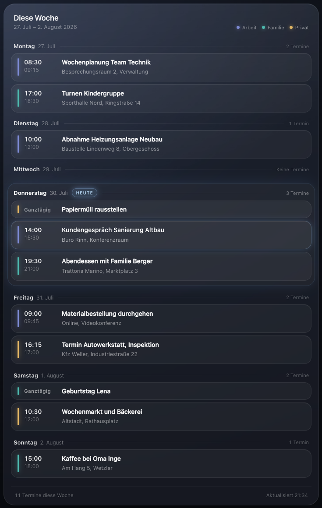

# Calendar Glass Card

Frosted-Glass Wochen-/Mehrtages-Agenda im Liquid-Glass-Stil für Home Assistant (`custom:calendar-glass-card`).
Zeigt einen oder mehrere `calendar`-Entities gruppiert nach Tag, mit Uhrzeit, Ort und einer farbigen
Legende pro Kalender. Design-Werte (Blur, Sättigung, Radien, Schatten, Farbpalette) sind auf die
Schwester-Karten (`thermostat-glass-card`, `weather-glass-card`, `saugroboter-card`) abgestimmt.



## Features

- Gruppiert Termine nach Tag über einen konfigurierbaren Zeitraum (1–14 Tage)
- Mehrere Kalender gleichzeitig, jeweils mit eigener Farbe und Legenden-Eintrag
- **Legende ist klickbar:** Tippen auf einen Eintrag blendet diesen Kalender aus (Punkt graut aus,
  Termine verschwinden aus der Liste, Zähler unten passt sich an) — erneutes Tippen holt ihn zurück
- Heute-Hervorhebung mit eigenem Badge und Glow-Rahmen
- Ganztägige Termine, Ort-Anzeige, "jetzt laufend"-Hervorhebung
- Auto-Refresh in konfigurierbarem Intervall

## Installation

1. `calendar-glass-card.js` als Lovelace-Ressource hinzufügen:
   - Settings → Dashboards → ⋮ → Resources → Add Resource
   - URL: z.B. `/hacsfiles/calendar-glass-card/calendar-glass-card.js` (via HACS) oder
     `/local/calendar-glass-card.js` (Datei manuell nach `config/www/` kopieren)
   - Resource type: JavaScript Module

## Konfiguration

```yaml
type: custom:calendar-glass-card
title: Kalender
days: 7
entities:
  - entity: calendar.arbeit
    name: Arbeit
    color: indigo
  - entity: calendar.familie
    name: Familie
    color: teal
```

| Option | Typ | Default | Beschreibung |
|---|---|---|---|
| `entities` | list | *(erforderlich)* | Liste aus Kalender-Entity-IDs (String) oder Objekten `{entity, name, color}` |
| `title` | string | *(automatisch, z. B. "Heute und die nächsten 6 Tage")* | Card-Titel |
| `days` | number | `7` | Anzahl angezeigter Tage (1–14) |
| `week_start` | string | `today` | `today` = heute + die nächsten N-1 Tage (rollierendes Fenster), `monday` / `sunday` = feste Kalenderwoche |
| `show_empty_days` | boolean | `true` | Tage ohne Termine mit anzeigen |
| `show_location` | boolean | `true` | Ort unter dem Termin anzeigen |
| `show_legend` | boolean | `true` | Legende anzeigen (nur bei >1 Kalender) |
| `show_footer` | boolean | `true` | Fußzeile mit Gesamtzahl & Aktualisierungszeit |
| `highlight_today` | boolean | `true` | Heute farblich hervorheben |
| `refresh_minutes` | number | `15` | Intervall für automatisches Neuladen der Termine |
| `blur` | number | `20` | Blur-Radius (px) des Glass-Panels |
| `saturate` | number | `180` | Sättigung (%) des Glass-Panels |
| `panel_shade` | number | `6` | Helligkeit des Panel-Hintergrunds (-100 bis 100) |
| `tile_shade` | number | `9` | Helligkeit der Termin-Kacheln (-100 bis 100) |
| `locale` | string | *(HA-Locale)* | Locale für Datums-/Zeitformatierung |
| `all_day_label` / `today_label` / `empty_label` / `range_label` / `updated_label` | string | *(nach HA-Sprache)* | Eigene Texte statt der eingebauten. Ohne Angabe folgen alle Texte der Home-Assistant-Sprache: Deutsch bei `de`, sonst Englisch (seit 1.1.0) |

### Farben

`color` je Entity akzeptiert: `deep-orange`, `orange`, `teal`, `indigo`, `cyan`, `pink`, `green`,
`red`, `blue`, `purple`, `amber`, `yellow`, `brown`, `grey`/`gray`, oder einen Hex-Code (`#RRGGBB`).
Ohne Angabe wird aus `indigo, teal, amber, cyan, pink, green` rotiert.

## Theme variables

Like the other Liquid Glass cards, this card reads two optional CSS variables, so one theme can align all of them:

```yaml
# in your Home Assistant theme
lg-radius: 22px                          # corner radius of the glass panel
lg-backdrop: blur(22px) saturate(180%)   # blur/saturation behind the panel
```

Without them nothing changes. Options set on the card itself (e.g. `blur`) still win.

## Changelog

### 1.1.0
- Reads the optional theme variables `--lg-radius` and `--lg-backdrop` (see *Theme variables*).
- Texte ("Heute", "Termine", "Ganztägig", …) folgen der Home-Assistant-Sprache: Deutsch bei `de`, sonst Englisch. Die `*_label`-Optionen überschreiben weiterhin.
- Versions-Banner in der Browser-Konsole.

## License

MIT (analog zu den Schwester-Karten `liquid-glass-tile-card`, `liquid-lens-navbar-card`,
`thermostat-glass-card`).
